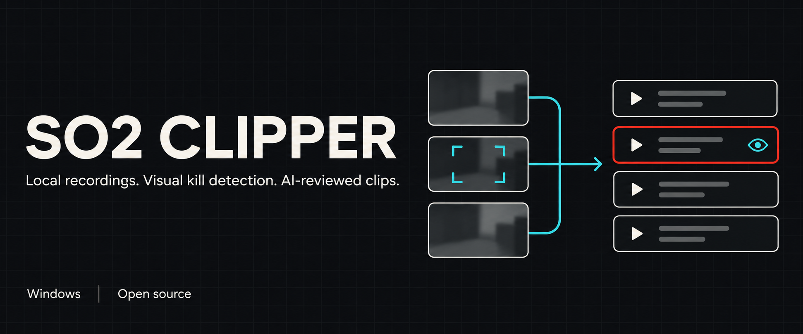
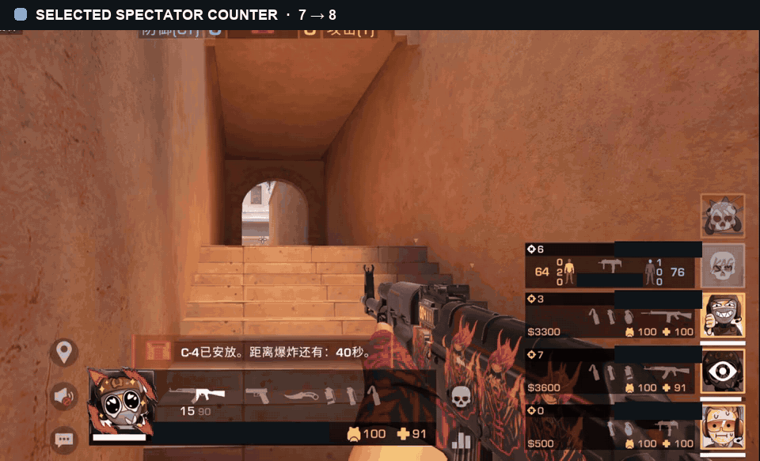
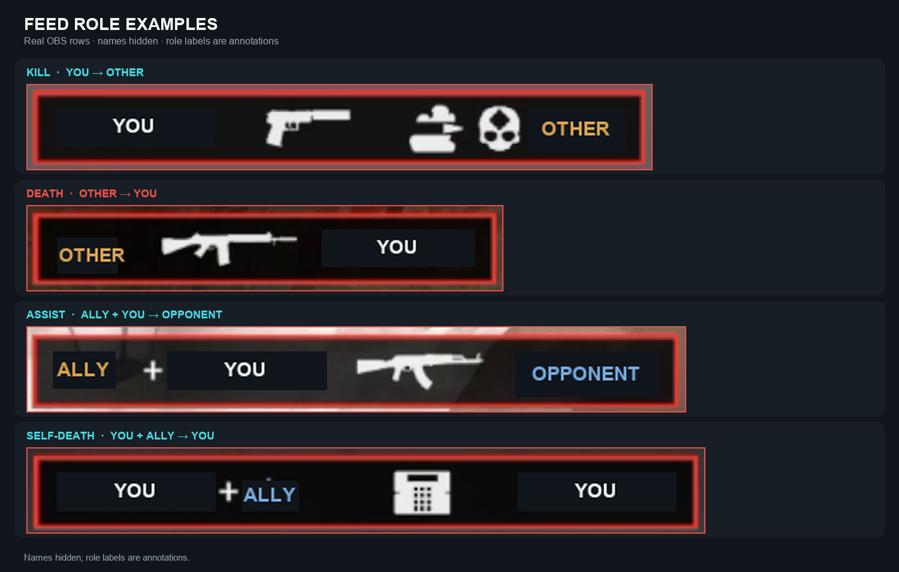
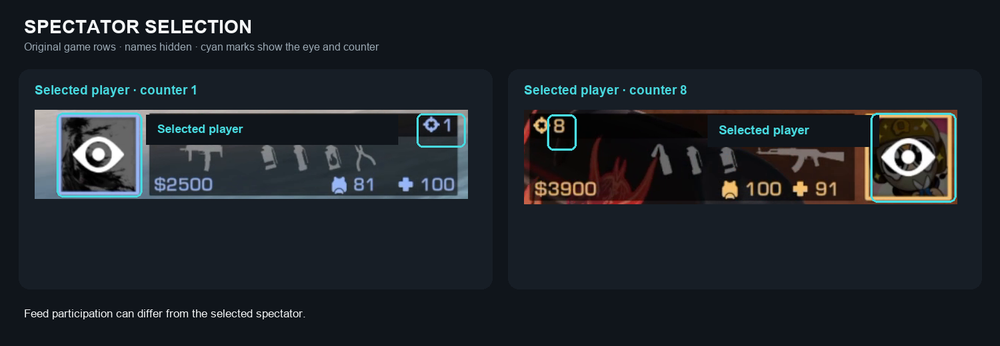
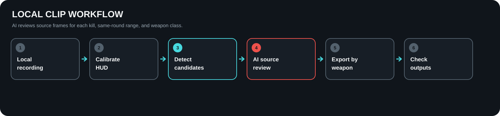

# SO2 Clipper

[](docs/usage.md)
[](LICENSE)
[](https://github.com/ScarfaceAI/so2-clipper/releases/tag/v0.2.0-beta.1)
[](https://github.com/ScarfaceAI/so2-clipper/actions/workflows/test.yml)

**Find kills in local Standoff 2 footage, let an AI review the evidence, and organize confirmed multi-kill clips for delivery.** No game ID is required by default. Player and spectator footage are supported. The local tool does not upload your recordings.

<p align="center"></p>

<p align="center"><em>The cover is a conceptual project illustration, not a desktop GUI. Actual in-game HUD examples appear below.</em></p>

## Get started

The recommended installation method is the Skills CLI:

```powershell
npx -y skills add ScarfaceAI/so2-clipper --skill so2-clipper -g
```

Reload skills in your AI tool, then provide a video file or folder. For example:

> Use so2-clipper to review the Standoff 2 recordings in `D:\Recordings` and deliver the confirmed multi-kill clips.

For manual installation, open the [v0.2.0-beta.1 Release](https://github.com/ScarfaceAI/so2-clipper/releases/tag/v0.2.0-beta.1), download the complete ZIP, extract it, and run `so2-clipper/scripts/install.ps1` in PowerShell. Reload the Skill in your AI tool afterward. Node.js is not needed for ZIP installation. See [installation and first run](docs/usage.md#installation).

On first run, the installer prepares a user-level Python environment, dependencies, FFmpeg (if a usable copy is not already available), and the EasyOCR model. Downloads may require several gigabytes. Supported environments are Windows 10/11 x64, Python 3.12/3.13, CPU, and NVIDIA acceleration. Source recordings stay on your computer. How your AI service handles screenshots or results that you choose to share with it depends on that service and its privacy settings.

<p align="center"></p>

## How it works

<p align="center"></p>

The scanner reads visual evidence such as the HUD feed, kill feedback, current avatar, and selected spectator target to produce candidate events. By default, it considers all identifiable current-viewpoint players in the recording. If a name is unreadable but visual attribution remains continuous, it can keep a stable anonymous identity. Filtering for a named player requires the name and viewpoint to be confirmed in the footage.

Warmup events are excluded from match kills. Viewpoint changes, identity loss, and round resets split candidate groups. Uncertain events remain in a review queue instead of being counted just to meet a target.

<p align="center"></p>

The scanner only supplies candidates. An AI must inspect source frames to confirm the player, kill count, full round boundaries, weapon category, and duplicates, then inspect the rendered clips and update delivery status. CLI candidates alone do not establish full-round curation or an accuracy guarantee. See the [review and delivery workflow](docs/usage.md#ai-review-and-delivery).

<p align="center"></p>

## Features

- Automatic current-viewpoint attribution without requiring a game ID by default; supports player and spectator views.
- Automatic checks for common HUD layouts, with uncertain layouts marked for review.
- Warmup filtering and candidate grouping by viewpoint and round boundaries.
- Incremental cache and resumable tasks; validated scans and outputs can be reused for the same task.
- MP4 clips based on AI-reviewed kill ranges; batch delivery can be organized by weapon category.
- Footage, cache, logs, and clips stay local. Runtime state defaults to `%LOCALAPPDATA%/SO2KillClips/tasks/`; new users' clips default to `output/<local date>/` inside the input folder.

## Documentation

- [Installation, CLI checks, and first use](docs/usage.md)
- [Validated behavior and limitations](skills/so2-clipper/references/validation.md)
- [Contributing and running checks](CONTRIBUTING.md)
- [Security reporting](SECURITY.md)
- [Changelog](CHANGELOG.md)
- [Glossary](CONTEXT.md)
- [Source of truth and generated files](SOURCE_OF_TRUTH.md)

## Releases and license

The first public release is **v0.2.0-beta.1** and remains in beta. Keep the complete Skill directory, including `runtime/`, when installing: both the npx Skills CLI and Release ZIP include the runnable runtime snapshot. Development changes are made only in the repository-root `scripts/`; CI checks that the committed `runtime/scripts/` copy matches the source. Download the complete Skill ZIP from [GitHub Releases](https://github.com/ScarfaceAI/so2-clipper/releases); the release page also provides a SHA-256 checksum.

The code is released under the [MIT License](LICENSE), with copyright attribution to ScarfaceAI. See [`THIRD_PARTY_NOTICES.md`](THIRD_PARTY_NOTICES.md) for third-party dependencies, FFmpeg, and model notices.

[简体中文 README](README.md)
