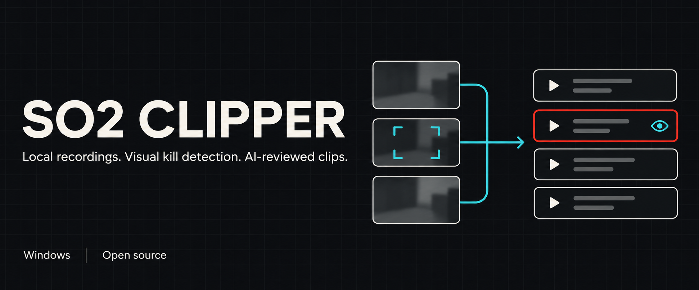
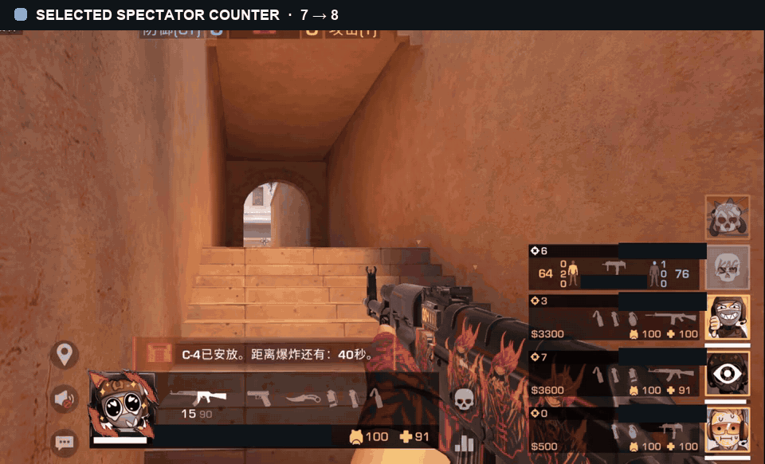
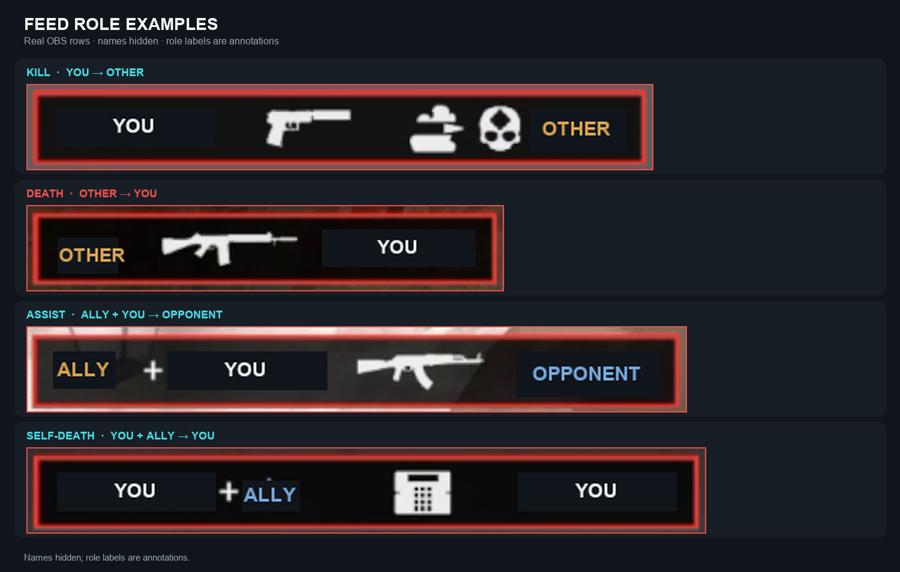
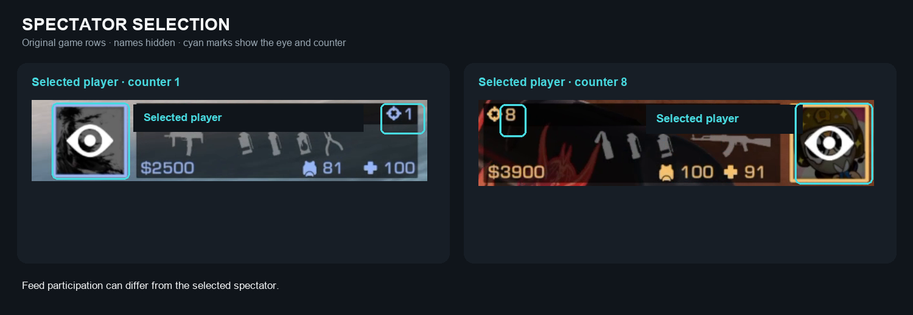
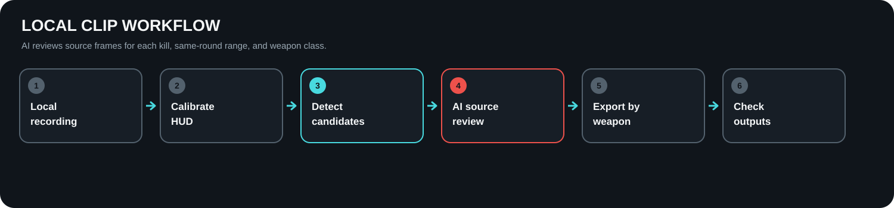

# SO2 Clipper

[](docs/usage.md)
[](LICENSE)
[](https://github.com/ScarfaceAI/so2-clipper/releases/tag/v0.2.0-beta.1)
[](https://github.com/ScarfaceAI/so2-clipper/actions/workflows/test.yml)

**从《对峙 2》录像中找出当前视角的击杀，把候选交给 AI 对照画面核实，整理成可交付的多杀片段。** 默认不需要填写游戏 ID；自己玩和观战都支持。录像由本地工具处理，不会由本项目上传。

<p align="center"></p>

<p align="center"><em>封面是项目概念示意图，不是桌面 GUI；下方另列实际游戏 HUD 示例。</em></p>

## 最快开始

推荐通过 Skills CLI 安装：

```powershell
npx -y skills add ScarfaceAI/so2-clipper --skill so2-clipper -g
```

在 AI 工具中重新加载 Skills，然后提供录像文件或目录，例如：

> 用 so2-clipper 处理 `D:\Recordings` 里的对峙 2 录像，交付确认过的多杀片段。

如果你更喜欢手动安装，打开 [v0.2.0-beta.1 Release](https://github.com/ScarfaceAI/so2-clipper/releases/tag/v0.2.0-beta.1)，下载完整 ZIP，解压后在 PowerShell 运行 `so2-clipper/scripts/install.ps1`，再让 AI 工具重新加载 Skill。ZIP 安装不需要 Node.js。完整步骤见[安装与首次运行](docs/usage.md#installation)。

首次运行会为当前用户准备 Python 运行环境、依赖、FFmpeg（若系统尚无可用版本）和 EasyOCR 模型，下载内容可能占用数 GB。支持 Windows 10/11 x64、Python 3.12/3.13、CPU 和 NVIDIA 加速。源录像留在本机；AI 服务如何处理你主动提供给它的截图或结果，取决于所用 AI 工具及其隐私设置。

<p align="center"></p>

## 它怎么工作

<p align="center"></p>

扫描器读取 HUD 播报、击杀反馈、当前头像和观战目标等画面信息，生成击杀候选。默认范围是录像里所有可确认的当前视角人物；名字读不清但视觉归属连续时，会保留匿名人物标识。若指定某个人，则必须在画面中确认名字和视角的对应关系。

热身会排除在正式击杀外；视角切换、身份丢失或回合重置会断开分组。证据不足的线索会进入待复核清单，不会为了凑数强行计杀。

<p align="center"></p>

扫描器只提供候选。AI 还需要查看源画面，逐杀确认人物、杀数、完整回合范围、武器类别和重复项，再查看成片画面并更新交付状态。普通 CLI 的候选结果本身不等于完整回合整理或准确率保证。完整步骤见[工作流说明](docs/usage.md#ai-review-and-delivery)。

<p align="center"></p>

## 功能一览

- 免填 ID，按实际画面自动归属当前视角；支持玩家视角和观战视角。
- 自动检查常见 HUD 布局，并把无法确定的布局标为待复核。
- 过滤热身，按人物视角和回合边界拆分候选。
- 增量缓存、断点续办；相同任务可复用已校验的扫描和输出。
- 支持按 AI 复核后的击杀范围生成 MP4；批量交付可按武器大类整理。
- 录像、缓存、日志和成片保存在本机。运行状态默认位于 `%LOCALAPPDATA%/SO2KillClips/tasks/`；新用户的成片默认放在输入目录的 `output/当地日期/`。

## 文档

- [安装、CLI 自检与首次使用](docs/usage.md)
- [已验证能力与边界](skills/so2-clipper/references/validation.md)
- [贡献代码和运行检查](CONTRIBUTING.md)
- [安全问题报告](SECURITY.md)
- [变更记录](CHANGELOG.md)
- [术语表](CONTEXT.md)
- [源码真源与生成文件](SOURCE_OF_TRUTH.md)

## 发布与许可

当前首个公开版本为 **v0.2.0-beta.1**，仍处于 Beta 阶段。安装时请保留完整 Skill 目录，包括 `runtime/`：npx Skills CLI 和 Release ZIP 均包含可运行的运行时快照。开发时只维护仓库根目录的 `scripts/`，CI 会检查提交的 `runtime/scripts/` 副本与真源一致。请从 [GitHub Releases](https://github.com/ScarfaceAI/so2-clipper/releases) 下载完整 Skill ZIP；发布页同时提供 SHA-256 校验值。

代码按 [MIT License](LICENSE) 发布，版权署名为 ScarfaceAI。第三方依赖、FFmpeg 和模型的说明见 [`THIRD_PARTY_NOTICES.md`](THIRD_PARTY_NOTICES.md)。

[English README](README.en.md)
